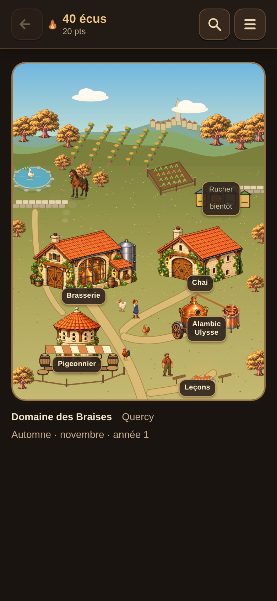
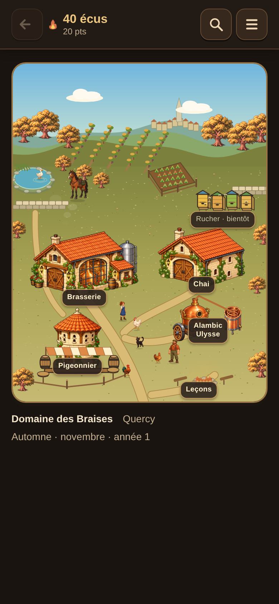

# Animations du domaine, du rucher et d'Ulysse

La branche `codex/animations-fluides` prolonge la PR #7 (`codex/univers-illustre`).
Le véritable HTML autonome est reconstruit dans `dist/index.html`, depuis les
sources du dépôt. Même site privé : https://promethee-ignem-custodimus.ivorycow37.chatgpt.site
Aucune fusion dans `main`.

## Ce qui change

- La carte et les panoramas animés passent de paliers de 120 ms à une animation
  continue via requestAnimationFrame, avec au plus 60 peintures par seconde.
  Décor statique et images restent en cache ; le chai statique n'entretient pas
  de boucle d'animation.
- Lise, Firmin, le cheval, les poules, le coq et le chat empruntent des Bézier,
  avec accélération, freinage, pauses et ombres au sol. Le canard nage sur la mare,
  avec des rides qui apparaissent et disparaissent progressivement. Les sprites
  d'origine restent identiques d'un écran à l'autre ; ce ne sont pas de nouvelles
  poses anatomiques de marche dessinées.
- Nuages, papillons, feuilles, neige et pigeons évoluent continûment ; les nuages
  ne reviennent plus brutalement au début de leur cycle toutes les 720 ms.
- Ruches : faces, hausses, pieds et planches d'envol plus lisibles ; nom déplacé
  sous le décor. Six abeilles décoratives volent le jour, hors hiver. **Le rucher
  reste l'extension fermée du jeu**, sans récolte ni règle de miel ajoutée.
- Alambic : fondu entre les six sprites du foyer, vapeur et gouttes sans apparition
  brutale, reflets discrets du cuivre. La flamme continue de lire la chauffe réelle
  et les gestes conservent les mêmes calculs, jauges, durées et coupes.
- Une horloge de présentation indépendante préserve les positions après masquage
  ou navigation ; aucun rattrapage brutal du temps absent. Mouvement réduit respecté.

Aucun asset WebP nouveau ni remplacé : 25 fichiers, toujours 1 317 438 octets.
Les cinq moteurs, `jeu.js`, données, recettes, sauvegardes, SQL, export et connexion
sont inchangés par rapport au lot précédent. `npm run test:presentation` confirme
également l'intégrité historique du contrôleur hors ses vingt raccords de dessin.

## Vérifications exécutées

- Build Node, `test:jeu`, `test:images`, `test:presentation`, `git diff --check` : réussis.
- `python qa/animations-fluides.py` : peintures réelles de la carte, avant/après,
  Chromium 390 × 844, DPR2. Dernier échantillon de 1 200 ms : **10 peintures avant,
  72 après**, soit environ **8 → 60 peintures/s**. Avec CPU ×4 : 72 peintures en
  1 200 ms (~60/s). Ce sont des mesures de ce Chromium, pas une garantie Android.
- Continuité des trajectoires, états gelés non modifiés, transitions aux six
  frontières du foyer, déplacement réel de Lise, pause/reprise sans saut,
  aucune peinture masquée, arrêt après navigation, mouvement réduit stable,
  aucune boucle pour le chai statique : réussis.
- Abeilles : six de jour en été, aucune la nuit ou en hiver, sur états visuels
  synthétiques gelés. Aucune incidence sur la progression réelle.
- La sauvegarde reste identique pendant les rendus. La navigation peut légitimement
  marquer un tutoriel comme vu ; les assertions isolent les périodes sans action.
- `python qa/parcours-mobile.py --sortie qa/animations` : 22 étapes capturées,
  du brassage à la vente, y compris deux chauffes et coupes manuelles,
  entonnage, vieillissement et reprise des sauvegardes de test. Zéro erreur JS.
- `python qa/univers-illustre.py --sortie qa/animations/univers --reference c3ab02a` :
  nouvelle partie, reprise, quatre saisons, illustrations corrompues/absentes,
  transparence, courbes expertes, mouvement réduit, largeurs 320/360/390/720 : réussis.
- `python qa/brasserie-illustree.py --sortie qa/animations/brasserie --reference c3ab02a` :
  véritables Touch Chromium, drag/drop, DPR2, hors écran, repli après erreur de
  dessin, captures A–E : réussis.

Rapports : [animations](resultats-animations.json), [parcours](resultats-mobile.json),
[univers](univers/resultats-univers.json), [ateliers](brasserie/resultats-graphiques.json).
Le profil lent à 1,6 Mbit/s charge toujours l'atelier en environ 10 secondes :
ce lot de fluidité ne résout pas la limite du transfert du HTML autonome.

## Preuves visuelles

| Avant | Après |
| --- | --- |
|  |  |

[Vidéo WebM du vrai Canvas animé](domaine.webm) — 3,5 secondes enregistrées dans
le jeu, et non une animation de démonstration séparée. Les libellés HTML ne sont
pas inclus dans cette capture du Canvas ; les PNG montrent l'interface complète.

## Limites

Tests Chromium avec émulation mobile, sans appareil Android physique ni Safari.
Les sauvegardes sont les fixtures de validation, pas la partie personnelle du
joueur. Les poses de marche articulées dessinées restent un enrichissement
artistique possible ; les déplacements actuels animent les sprites existants.
Le classement à l'aveugle n'a pas été déclenché par la fixture du parcours complet,
comme dans le lot précédent ; le rendu des verres est testé séparément.
