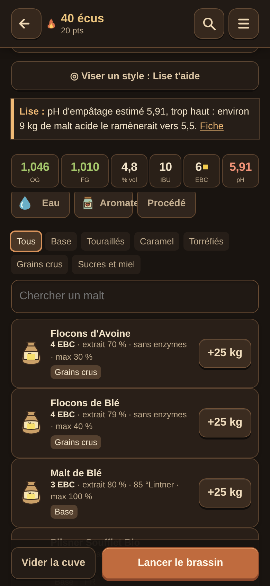
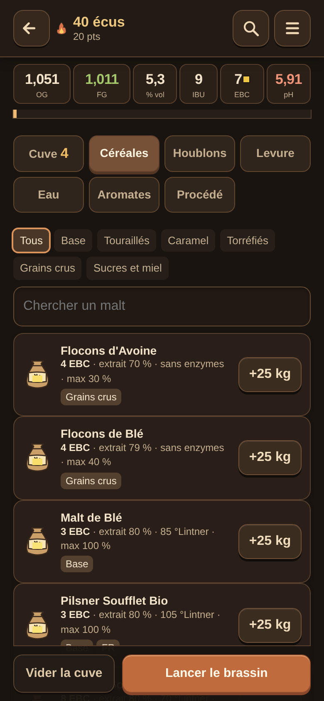

# Bandeau en haut et onglets textuels

Branche `codex/bandeau-haut-onglets-texte`, basée sur la PR #9.
Vrai jeu reconstruit dans `dist/index.html` ; même site privé :
https://promethee-ignem-custodimus.ivorycow37.chatgpt.site

## Correction

Le bandeau OG/FG/alcool/IBU/EBC/pH avait un `top:149px` (129px sur petit écran),
alors que l'atelier n'était plus collant. Il restait donc au milieu de l'écran.
Il est maintenant le premier élément de la brasserie, collant à `top:0` dans
la scène de défilement, immédiatement sous l'en-tête de l'application.
Le remplissage supérieur de cette seule page est ajusté pour qu'il soit en haut
dès l'entrée, avec la même position après défilement.

Conformément à la précision utilisateur « Seulement les pictogrammes des onglets »,
les onglets recette et fournisseurs sont textuels. Les pictogrammes ne sont plus
injectés dans ces boutons à chaque changement d'onglet. Les grandes illustrations,
les scènes de fabrication, les poignées d'ingrédients et les filtres de recherche
restent inchangés. Aucun calcul, commande ou format de sauvegarde n'est modifié.

## Vérifications exécutées

- Build Node, `npm run test:jeu`, `test:images`, `test:presentation`,
  `git diff --check` : réussis.
- `python qa/bandeau-onglets.py` : bandeau au même `top` que la scène (69px dans
  cet environnement), dès l'entrée et aux défilements 160, 550 et maximum, aux
  largeurs 320/390/720 ; aucun débordement horizontal. Sept onglets recette et
  huit onglets fournisseurs : sélections fonctionnelles et aucun pictogramme
  après chaque rerendu. Ajout tactile de malt et actualisation des mesures ;
  le bouton pH ouvre sa vraie fiche ; grandes illustrations toujours présentes.
- `python qa/brasserie-illustree.py --sortie qa/bandeau-onglets/brasserie --reference 579606a` :
  drag/drop vers la vraie cuve, vrais Touch CDP avec annulation, DPR2, mouvement
  réduit, images absentes/corrompues et erreur de dessin injectée : réussis.

Le parcours de fabrication complet avait été validé dans la PR #9 ; il n'a pas
été relancé pour ces corrections de présentation. Le contrôleur `jeu.js`, les
cinq moteurs, données et sauvegardes restent identiques. Les reprises de la QA
utilisent des fixtures issues de main, aucune partie personnelle du joueur.
Tests dans Chromium avec émulation mobile, pas sur Android physique ou Safari.

[Rapport des positions et interactions](resultats.json) ·
[Rapport de la brasserie](brasserie/resultats-graphiques.json)

| Avant, bandeau flottant | Après, bandeau en haut |
| --- | --- |
|  |  |

[Vue d'entrée et onglets textuels à 390px](captures/apres-390.png).
