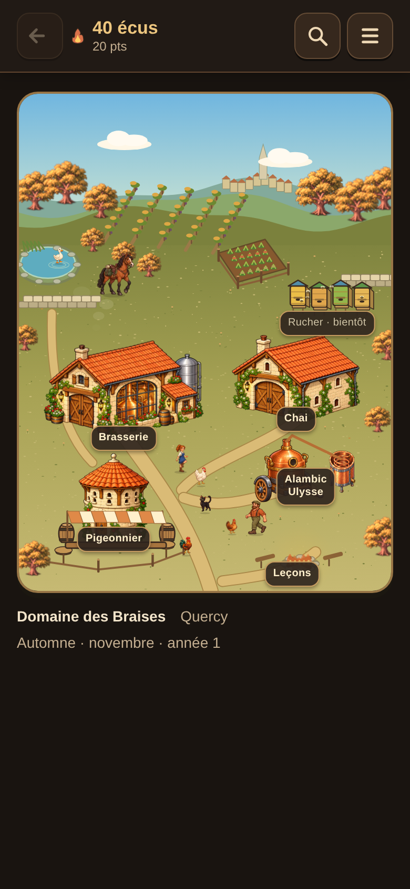

# Poses dessinées et détails animés

Branche `codex/animations-detaillees`, basée sur la PR #8 (`codex/animations-fluides`).
Le vrai jeu est construit depuis `jeu/src/` dans `dist/index.html` et publié sur
https://promethee-ignem-custodimus.ivorycow37.chatgpt.site, avec la même audience privée.
Aucune fusion dans `main`.

## Illustrations réellement animées

Quatre nouveaux atlas WebP Q82, chacun **six dessins de poses** en trois colonnes
et deux lignes de 128 × 128 :

| Atlas | Action | Poids |
| --- | --- | --- |
| `marche-lise.webp` | Jambes, bras et robe pendant la marche | 21 926 octets |
| `marche-firmin.webp` | Alternance des jambes et des bras | 22 912 octets |
| `pas-cheval.webp` | Appuis des sabots, tête et queue | 31 784 octets |
| `picorer-poule-blanche.webp` | Cou et bec abaissés puis redressés | 30 532 octets |

Les poses sont générées avec `image_gen` en référence aux sprites du domaine,
puis extraites, alignées et regroupées techniquement avec ImageMagick. Les quatre
PNG finaux restent dans `/workspace/generated_images` : `exec-407809ca-4d63-44ac-af78-74a6efce4b6c.png`,
`exec-c2ea9e07-4340-4f40-a684-2ae862d61a23.png`, `exec-68c1e3a0-6ba0-4b31-8a39-5e82389d9960.png`,
`exec-aec7bd08-5538-4622-a9ce-469951173661.png`.

Les pieds restent au même ancrage et la hauteur visible correspond au sprite de
référence. La progression sur le chemin choisit les poses de marche, pour que
les pas suivent le déplacement ; un fondu accompagne le départ et l'arrêt. La
poule picore pendant ses pauses. Les sprites de référence restent le repli, et les
portraits d'origine sont conservés. Aucun visage de portrait n'est remplacé.

Le jeu compte maintenant **29 WebP, 1 424 592 octets (~1,36 Mio)** sur 6 Mio permis.
Le [manifest](../../jeu/src/images/manifest.json) contient les dimensions, SHA256
et ancrages. Aucun atlas ne dépasse 384 × 256 ; aucun WebP animé n'est utilisé.

## Détails du décor et des activités

- Feuillage légèrement déformé par le vent, avec tronc et sol fixes. Les textures
  à la bonne taille et leur teinte saisonnière sont mises en cache : aucun filtre
  de couleur lourd n'est appliqué à chaque bande à chaque image.
- Auvents souples sur le domaine et au pigeonnier ; respiration discrète des
  mentors présents dans la boutique et à la veillée.
- Éclairage du foyer légèrement vivant, braises flottantes, petites rides sur
  les surfaces liquides des ateliers et le hublot d'Ulysse. Les niveaux affichés,
  la chauffe, les gestes, les jauges et les coupes restent liés au vrai jeu.
- Les 25 illustrations précédentes sont inchangées. Le rucher reste fermé et
  décoratif ; le chai n'entretient toujours pas de boucle d'animation inutile.

## Contrôles exécutés

- Build réel, `test:jeu`, `test:images`, `test:presentation`, `git diff --check` :
  réussis. **`jeu.js` et les cinq moteurs sont identiques à la PR #8** ; données,
  recettes, économie, progression, sauvegardes `ignem.v1`, SQL, export et connexion
  ne changent pas.
- `python qa/poses-detaillees.py` : quatre atlas décodés dans Chromium, 24 cellules
  avec vrais pixels transparents, six dessins distincts du bas du corps par atlas,
  baseline commune à deux pixels près. Le renderer utilise réellement les six
  rectangles, et les six poses de Lise sont observées dans la vraie carte.
  Atlas absent ou aux dimensions invalides : repli ; sauvegarde identique durant
  les rendus ; mouvement réduit stable. [Rapport](resultats-poses.json).
- `python qa/animations-fluides.py --sortie qa/details-animations --reference 0881e9b` :
  390 × 844, DPR2, **73 peintures avant / 72 après sur 1 200 ms** ; 69 avec CPU ×4.
  La cadence se maintient autour de 60 peintures/s sur ce Chromium. Trajectoires,
  pause/reprise, hors écran, mouvement réduit, abeilles jour/nuit/hiver et chai
  statique passent. [Rapport](resultats-animations.json).
- `python qa/parcours-mobile.py --sortie qa/details-animations` : 22 étapes et
  captures, recette et gestes A–E, sauvegarde/reprise, deux chauffes avec coupes
  manuelles, entonnage, vieillissement, embouteillage et vente : réussis, zéro
  erreur JavaScript observée. [Rapport](resultats-mobile.json).
- `python qa/univers-illustre.py --sortie qa/details-animations/univers --reference 0881e9b` :
  nouvelle partie, fixtures, alpha, quatre saisons, largeurs 320/360/390/720,
  courbes expertes, mouvement réduit et illustrations manquantes : réussis.
- `python qa/brasserie-illustree.py --sortie qa/details-animations/brasserie --reference 0881e9b` :
  vrais Touch CDP, drag/drop, DPR2, repli après erreur de dessin injectée et
  captures A–E : réussis.
- `python qa/performance-mobile.py --sortie qa/details-animations/performance-4g.json` :
  HTTP gzip réel, 10 Mbit/s, RTT80ms, CPU ×4, cache vide : carte prête en **2 968 ms**
  sur cet essai. Au profil lent 1,6 Mbit/s de la QA brasserie : atelier prêt en
  environ **10,7 s**. Ces mesures simulées ne garantissent pas celles d'un Android.

La première version du vent ralentissait trop le rendu ; la mise en cache des
textures saisonnières et la réduction des bandes ont résolu le problème. Le
contrôle de cadence a ensuite été relancé avec succès.

## Captures et vidéo du vrai jeu

[Marche de Lise, six poses rendues](captures/poses-lise.png) ·
[Carte détaillée](captures/domaine-details.png) ·
[Vidéo du vrai Canvas animé, 3,5 secondes](domaine.webm).

| Avant PR #8 | Après |
| --- | --- |
|  |  |

La vidéo capture le Canvas réel ; les libellés HTML apparaissent dans les PNG.
Les autres captures et rapports sont conservés dans `captures/`, `univers/` et
`brasserie/`. Les états des saisons et courbes expertes restent des fixtures
visuelles explicites, pas une progression artificielle du joueur.

## Limites artistiques et matérielles

La marche est stylisée, avec un pas marqué ; certaines poses de passage des deux
triplets sont proches. Les nouvelles anatomies concernent Lise, Firmin, le cheval
et la poule blanche. Le chat, le coq, la poule brune et le canard conservent leurs
sprites précédents et leurs mouvements procéduraux ; leurs cycles articulés et
les poses de travail des mentors restent des enrichissements possibles.

Tests en émulation Chromium mobile, pas sur Android physique ou Safari. Pas de
sauvegarde personnelle disponible ; les reprises portent sur les fixtures issues
de main. Le classement aveugle n'a pas été déclenché par la fixture de distillation
(fractions insuffisantes selon les règles) ; son rendu uniforme est vérifié séparément.
