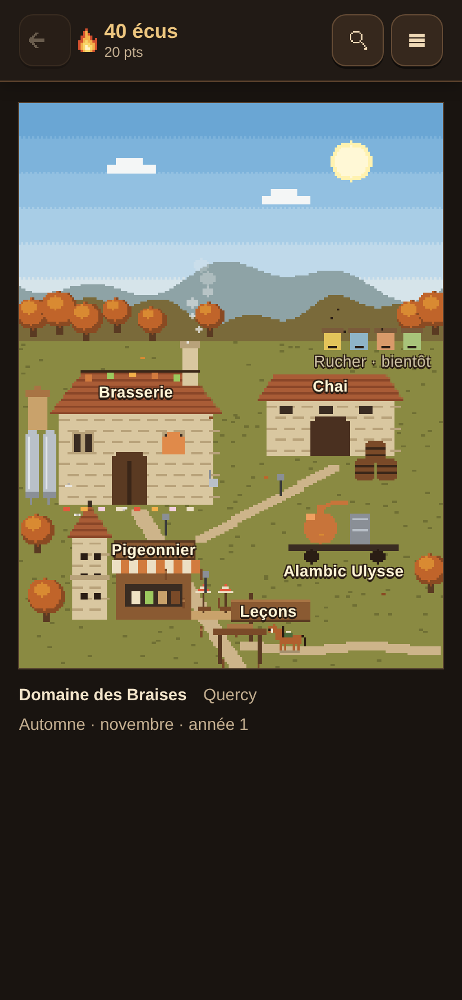
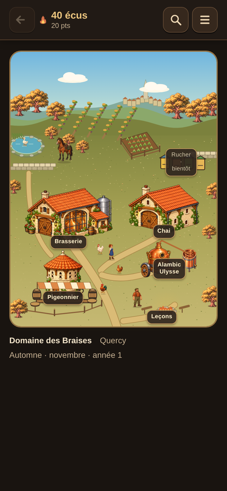

# Univers illustré — lot F à R, continuité de la brasserie

Le **vrai jeu** est généré depuis `jeu/src/` dans [`dist/index.html`](../../dist/index.html).
La branche `codex/univers-illustre` prolonge `codex/fonds-sombres` (PR #6).
Elle dépend de la chaîne de PR #2 → #3 → #4 → #5 → #6, toujours sans fusion
sur `main` pendant ce chantier. Aucune application parallèle n'a été créée.

Version mobile : https://promethee-ignem-custodimus.ivorycow37.chatgpt.site
(même adresse et même audience privée ; la sauvegarde reste locale à ce site).

## Changements jouables

- **A–E** : ateliers illustrés conservés ; les nouveaux pictogrammes et le portrait
  cohérent de Lise s'y appliquent également.
- **F** : chaudière mobile et condenseur Ulysse indépendants, liquides, feu,
  mousse, vapeur, récipients, instruments et tuyaux par code. La bonne chauffe
  conserve les six courbes des congénères et le degré en mode expert.
- **G** : cave voûtée, fûts indépendants, verrerie et pipette. Panorama des fûts
  effectivement placés ; casse-tête, zones climatiques et toutes ses commandes conservés.
- **H** : pigeonnier, auvent, comptoir, bouteilles et terrasse selon le niveau réel ;
  portraits des clients en SVG, sans retoucher les offres ni les ventes.
- **I–J** : verres vectoriels, reflets, liquides translucides, bouteilles et
  pictogrammes cohérents. Verres aveugles identiques pour ne pas révéler les coupes.
- **K–M** : veillée nocturne, mobilier, feu ; Lise/Firmin identiques dans les
  panoramas, sur le domaine et dans leurs portraits recadrés du même sprite.
  Navigation arrondie, cuivre/chêne, Lilita One et fonds espresso conservés.
- **N–Q** : bâtiments par niveaux, terrains libres, chantiers, végétation,
  verger/vigne/potager, mare, animaux, quatre saisons et éclairage nocturne.
  Repères et zones cliquables historiques 192 × 256 conservés.
- **R** : six images de flamme générées en mémoire, cadence 120 ms ; effets
  procéduraux et six positions discrètes au repos. Cache des décors, DPR plafonné
  à 2,5, lissage, chargement asynchrone, repli, arrêt hors écran et mouvement réduit.

25 WebP originaux Q82, total **1 317 438 octets** (~1,26 Mio), sous 6 Mio.
Équipements séparés et transparence réelle vérifiée par décodage dans Chromium.
Les six bâtiments ont le même canevas et le même ancrage au sol.
Voir [manifest](../../jeu/src/images/manifest.json) et [contrat des assets](../../jeu/src/images/README.md).

## Préservation du jeu

`npm run test:presentation` vérifie les SHA256 inchangés des cinq moteurs et
l'identité **exacte** du contrôleur historique après retrait de vingt lignes de
raccords de présentation (sept précédentes et treize nouvelles).
Les données scientifiques, recettes, économie, progression, format de sauvegarde,
SQL, export et connexion restent inchangés. La clé reste `ignem.v1`.

Les deux fixtures sont des sauvegardes **de test**, produites à partir de `main`
pendant l'audit. Aucune sauvegarde personnelle d'un joueur n'était disponible.
Ne pas les confondre avec une validation sur toutes les parties possibles.

## Vérifications exécutées

- `node scripts/construire-jeu.mjs`, `npm run test:jeu`, `npm run test:images`,
  `npm run test:presentation`, `git diff --check` : réussis.
- `python qa/parcours-mobile.py --sortie qa/univers` : 22 étapes/captures ;
  vraie recette, tous gestes A–E, reprise, deux chauffes Ulysse avec bûche,
  registre et coupes manuelles, entonnage, vieillissement, embouteillage et vente.
  Zéro erreur JavaScript ou débordement observé.
- `python qa/univers-illustre.py` : nouvelle partie vierge et sauvegarde après
  ajout tactile de malt ; portraits, transparence, panoramas, quatre saisons,
  niveaux maximum, largeurs 320/360/390/720, réduction du mouvement, repli sans
  images et images corrompues. Rendu expert sur état gelé, six flammes distinctes,
  arrêt hors écran, verrerie aveugle uniforme, sauvegarde intacte par le rendu.
  Les saisons/niveaux et courbes de cette QA sont des **états visuels synthétiques**.
- `python qa/brasserie-illustree.py --sortie qa/univers/brasserie --reference 40210bc` :
  drag/drop et vrais Touch Chromium via CDP, DPR2, cache/hors écran, images
  manquantes/corrompues, `drawImage` volontairement en erreur, captures A–E.
  L'injection a révélé une exception du recadrage des portraits : corrigée et
  toute cette suite relancée avec succès.
- `python qa/performance-mobile.py` : vraie réponse HTTP gzip sous débit/CPU
  simulés, cache vide ; mesure 4G dans [performance-4g.json](performance-4g.json).
  La carte est prête en environ **2,9 s** à 10 Mbit/s, RTT80ms et CPU×4.
  Sous 1,6 Mbit/s, RTT150ms et CPU×4 : DCL **8,6 s**, atelier prêt **9,9 s**.
  L'objectif 3 s n'est donc pas tenu sur ce profil lent. Mesures locales Chromium,
  un essai par profil, aucune garantie de performance sur Android physique.

Rapports : [parcours](resultats-mobile.json), [univers](resultats-univers.json),
[brasserie](brasserie/resultats-graphiques.json). Les PNG sont conservés dans
[captures](captures/) et [captures A–E](brasserie/captures/).

## Comparaison visuelle

| Avant, fonds sombres précédents | Après, domaine et personnages illustrés |
| --- | --- |
|  |  |

Autres vues : [Ulysse](captures/10-brouillis.png), [chai](captures/chai-apres.png),
[boutique](captures/catalogue-apres.png), [veillée](captures/veillee-apres.png),
[printemps](captures/saison-1.png), [hiver](captures/saison-4.png).

## Limites et suite artistique

Aucun asset ne manque pour utiliser les écrans livrés. Les enrichissements restants
sont les véritables poses anatomiques de marche/travail sur six images pour
personnages/animaux, des portraits peints individualisés des clients, et des
variantes hivernales peintes (les branches et la neige sont actuellement par code).
Les animations actuelles ne sont pas présentées comme ces poses dessinées.

La fixture de distillation n'a pas déclenché l'écran du classement à l'aveugle
(fractions insuffisantes selon les règles) : ce parcours précis n'est pas annoncé
comme testé. Le rendu uniforme des verres a été vérifié séparément. Les mesures
scientifiques et tous les contrôles de cet écran sont conservés par le garde-fou.

Tests exécutés sur Chromium avec émulation mobile et toucher ; pas de téléphone
Android physique ni Safari iOS disponible. `file://` est interdit par la politique
du Chromium fourni : la version HTTP autonome est testée, l'ouverture locale sur
un téléphone reste à vérifier. Le rucher demeure l'extension « bientôt » du jeu.
